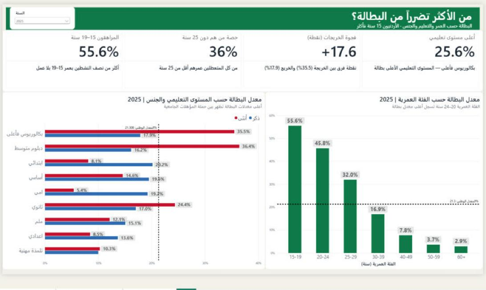
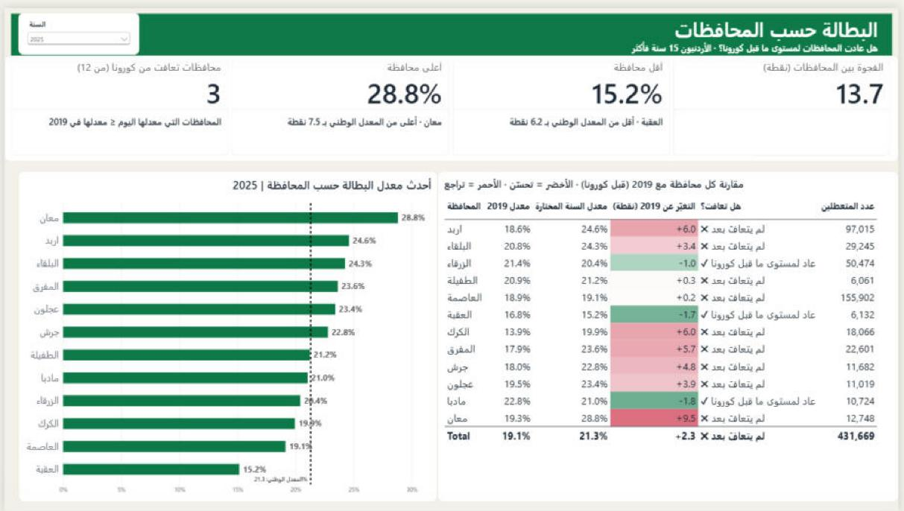

# 🇯🇴 Jordan Labour Market Dashboard (2017–2025)

An interactive **Power BI** dashboard analysing unemployment among Jordanians aged 15+ across nine years, by **gender, age, education and governorate**, built on the official Labour Force Survey from Jordan's Department of Statistics (DoS).

> **1 in 3 female university graduates in Jordan is unemployed — for male graduates it is about 1 in 6.**



---

## 📌 Key findings (2025)

| Indicator | Value |
|---|---|
| National unemployment rate (Jordanians 15+) | **21.3%** — still above the pre‑COVID 2019 level (19.1%) |
| Female vs male unemployment | **33.2%** vs **17.9%** — the gap has not narrowed since 2017 |
| Female vs male university graduates | **35.5%** vs **17.9%** — nearly double |
| Youth unemployment | **55.6%** (ages 15–19) · **45.8%** (ages 20–24) |
| Governorates back to pre‑COVID level | **3 of 12** — highest Ma'an (28.8%), lowest Aqaba (15.2%) |

National rates by year (computed from the cleaned data and checked against DoS published figures):

| 2017 | 2018 | 2019 | 2020 | 2021 | 2022 | 2023 | 2024 | 2025 |
|---|---|---|---|---|---|---|---|---|
| 18.3% | 18.6% | 19.1% | 23.2% | 24.1% | 22.8% | 22.0% | 21.4% | 21.3% |

---

## 🖥️ Dashboard pages

1. **The Big Picture** — headline KPIs and the female vs male unemployment trend 2017–2025, with the COVID years highlighted.
2. **Who Is Most Affected?** — unemployment by education × gender and by age group, each compared with the national average.
3. **Governorates** — latest rate per governorate with a national reference line, plus a table comparing every governorate with 2019 (green = improved, red = worse).



Every title and KPI is **dynamic** and updates automatically with the Year slicer.

---

## 🛠️ How it was built

**Data source:** DoS Labour Force Survey databank (PX‑Web) — tables *EMPALL* (employed Jordanians) and *EMPALL1* (unemployed Jordanians).
https://jorinfo.dos.gov.jo/Databank/pxweb/ar/DOS_Database/START__12/

**1. Data cleaning — Power Query** (also reproduced in Python in `scripts/clean_data.py`)
- Removed title/footer metadata rows and promoted headers
- Filled down visually merged dimension cells
- Trimmed text and removed Arabic *tatweel* characters
- Unpivoted year columns into a long table
- Grouped and merged the employed and unemployed tables on 6 keys → **27,216 rows, 100% match**
- Validated the resulting national rates against official DoS figures

**2. Data model & DAX** — 50+ measures organised in folders (Core / Time / Groups / Text), including:
- Ratio‑of‑sums unemployment rate (not an average of rates)
- Latest‑year and 2019 baseline comparisons
- Dynamic titles and narrative KPI labels driven by the selected year
- See `dax/key_measures.dax`

**3. Design** — custom theme (`dashboard/Jordan_Labour_Theme.json`), consistent colour meaning across pages (crimson = female, blue = male, gold = 2019 baseline, green = national/latest), Arabic RTL layout.

---

## 📁 Repository structure

```
├── dashboard/
│   ├── jordan-labour-market.pbix      # Power BI report
│   └── Jordan_Labour_Theme.json       # custom report theme
├── data/
│   ├── raw/                           # original DoS exports (employed / unemployed)
│   └── processed/                     # clean merged dataset (27,216 rows)
├── dax/key_measures.dax               # main DAX measures
├── scripts/clean_data.py              # reproducible cleaning + validation pipeline
└── images/                            # dashboard screenshots
```

## ▶️ How to use

- **Explore the dashboard:** download `dashboard/jordan-labour-market.pbix` and open it in [Power BI Desktop](https://www.microsoft.com/power-platform/products/power-bi/desktop) (free, Windows). Use the Year slicer to move between 2017 and 2025.
  *If the report asks to refresh, update the two source file paths in Power Query (Transform data → Data source settings) to the files in `data/raw/`.*
- **Reproduce the clean dataset:**
  ```bash
  pip install -r requirements.txt
  python scripts/clean_data.py
  ```

## ⚠️ Notes

- Unemployment rate = unemployed ÷ (employed + unemployed), Jordanians aged 15+.
- Figures are survey‑based estimates from a sample, as published by DoS.

## 👤 Author

**Abdullah Asasfeh** — AI & Data Science graduate
